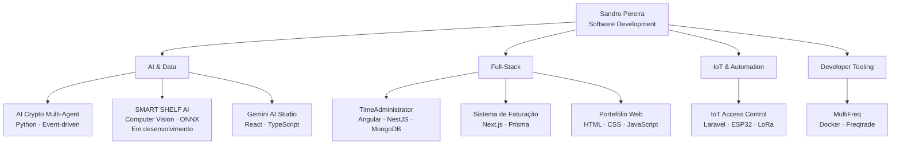

**Transformo problemas em aplicações, sistemas integrados e experiências digitais.**

[🇵🇹 Português](#-sobre-mim) · [🇬🇧 English](#english)

---

## 🇵🇹 Sobre mim

Sou um profissional de tecnologia com formação em **Desenvolvimento Web e Multimédia** e foco no desenvolvimento de software. Exploro a intersecção entre **engenharia de software, inteligência artificial, aplicações Full-Stack, automação e IoT**.

Interessa-me construir soluções completas: compreender o problema, desenhar a arquitetura, implementar, testar, documentar e melhorar. Dou especial atenção à modularidade, segurança, manutenção e experiência de utilização.

- 🧠 **AI Engineering:** sistemas multiagente, integração de modelos e experiências com IA.
- 👁️ **Computer Vision:** exploração de processamento visual e inferência de modelos.
- 🧱 **Full-Stack:** aplicações Web, APIs, autenticação e persistência de dados.
- ⚙️ **DevOps & Automation:** Docker, automação e pipelines de desenvolvimento.
- 📡 **IoT:** integração entre firmware, dispositivos e plataformas Web.

> **Transparência:** tecnologias e áreas apresentadas refletem projetos e aprendizagem prática. Não são uma escala de proficiência nem uma lista de certificações. Projetos em desenvolvimento não são apresentados como produtos concluídos.

## 🧭 Áreas de trabalho

| 🤖 Inteligência Artificial | 🧩 Engenharia de Software | 🌐 Sistemas Integrados |
|:---:|:---:|:---:|
| Agentes e orquestração | Frontend e Backend | IoT e firmware |
| Integração de modelos | APIs e bases de dados | Comunicação de dispositivos |
| Visão computacional | Testes e arquitetura | Automação operacional |

## 🗺️ Mapa do ecossistema de projetos

## ⭐ Projetos em destaque

<table>
<tr>
<td width="50%" valign="top">

### 🤖 AI Crypto Multi-Agent

Framework modular de trading orientado a eventos, com agentes especializados, backtesting, gestão de risco e integração com exchanges através de CCXT.

**Pontos técnicos**
- Agentes de regime, scanner, risco, supervisão e execução.
- Event bus assíncrono.
- Backtesting com slippage e comissões.
- Políticas configuráveis.

[↗ Explorar repositório](https://github.com/smpsandro1239/AiCryptoMultiAgente)

</td>
<td width="50%" valign="top">

### 🧠 SMART SHELF AI

Projeto em desenvolvimento orientado para análise inteligente de prateleiras, processamento visual e utilização segura de modelos de inferência.

**Foco de engenharia**
- Pipeline de Computer Vision.
- Gestão e validação de modelos ONNX.
- Segurança e integridade de artefactos.
- Integração entre componentes.

**Estado:** em desenvolvimento; não apresentado como produto concluído.

</td>
</tr>
<tr>
<td width="50%" valign="top">

### 📡 IoT Access Control

Sistema de controlo de acessos e gestão de barreiras que integra aplicação Web, backend e firmware.

**Pontos técnicos**
- Laravel, PHP e MySQL.
- Firmware ESP32 em C++.
- Comunicação LoRa.
- Dashboard e gestão de dispositivos.

[↗ Explorar repositório](https://github.com/smpsandro1239/IOT)

</td>
<td width="50%" valign="top">

### 🧑‍💼 TimeAdministrator

Aplicação de gestão de clientes e subscrições com áreas administrativa e de cliente.

**Pontos técnicos**
- Angular e TypeScript.
- API NestJS.
- MongoDB e Mongoose.
- Docker, autenticação e notificações.

[↗ Explorar repositório](https://github.com/smpsandro1239/TimeAdministrator)

</td>
</tr>
<tr>
<td width="50%" valign="top">

### ⚙️ MultiFreq

Ferramentas para gerir instâncias Freqtrade, estratégias e fluxos de backtesting.

**Áreas**
- Contentorização e gestão de serviços.
- Automação de operações.
- Ferramentas de apoio a estratégias.

[↗ Explorar repositório](https://github.com/smpsandro1239/MultiFreq_)

</td>
<td width="50%" valign="top">

### 🖥️ Portefólio Web

Portefólio construído com tecnologias Web nativas, com foco em apresentação de projetos e experiência de utilização.

**Áreas**
- HTML semântico, CSS e JavaScript.
- Responsividade e acessibilidade.
- SEO, PWA e GitHub Actions.

[↗ Código-fonte](https://github.com/smpsandro1239/portfolio-dev-senior) · [↗ Ver site](https://smpsandro1239.github.io/portfolio-dev-senior/)

</td>
</tr>
</table>

### Outros projetos

| Projeto | Descrição | Stack principal |
|---|---|---|
| [Sistema de Faturação AT](https://github.com/smpsandro1239/Sistema-de-Faturacao-AT) | Aplicação de faturação e gestão comercial; qualquer alegação de conformidade fiscal carece de validação formal. | Next.js, TypeScript, Prisma |
| [Gemini AI Studio](https://github.com/smpsandro1239/Curso_JavaScript_2025_2) | Experiência Web com integração da API Gemini. | React, TypeScript, Vite |

## 🧰 Tecnologias

**Linguagens**

**Frontend & Backend**

**Dados, DevOps & Ferramentas**

**IA & Hardware**

## 📊 Atividade no GitHub

> Os cartões de estatísticas são gerados por serviços externos e podem ter limites de disponibilidade ou atualização. As métricas apresentadas não substituem a análise dos repositórios.

## 🎓 Formação

**TeSP em Desenvolvimento Web e Multimédia** — formação na área de desenvolvimento Web e tecnologias multimédia.

Experiência académica e prática em programação, bases de dados, redes de computadores, sistemas e desenvolvimento de aplicações.

## 🤝 Contacto e colaboração

Tenho interesse em projetos de desenvolvimento de software, integração de IA, aplicações Full-Stack, automação e sistemas IoT.

- **GitHub:** [@smpsandro1239](https://github.com/smpsandro1239)
- **Portefólio:** [smpsandro1239.github.io/portfolio-dev-senior](https://smpsandro1239.github.io/portfolio-dev-senior/)
- **Contacto profissional:** através do GitHub — [iniciar conversa](https://github.com/smpsandro1239)

---

**Construir · Testar · Medir · Aprender · Melhorar**

---

## 🇬🇧 English

Software developer with a background in **Web Development and Multimedia**, focused on building software across **AI engineering, full-stack applications, automation and IoT**.

I enjoy working across the full development lifecycle: understanding problems, designing solutions, implementing, testing, documenting and iterating. My public repositories showcase experiments and projects involving multi-agent systems, computer vision, web applications, embedded devices and developer tooling.

**Featured work:** AI Crypto Multi-Agent · SMART SHELF AI (in development) · IoT Access Control · TimeAdministrator · MultiFreq · Web Portfolio.

**Education:** Higher Professional Technical Course (TeSP) in Web Development and Multimedia.

**GitHub:** [github.com/smpsandro1239](https://github.com/smpsandro1239) · **Portfolio:** [smpsandro1239.github.io/portfolio-dev-senior](https://smpsandro1239.github.io/portfolio-dev-senior/)
